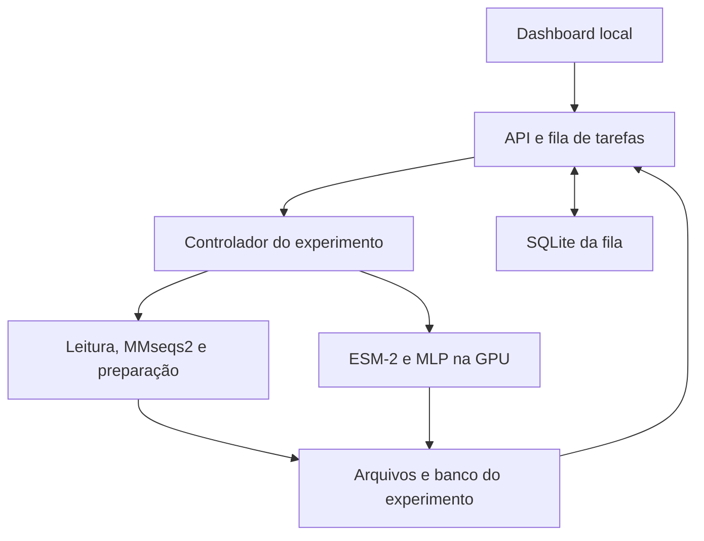
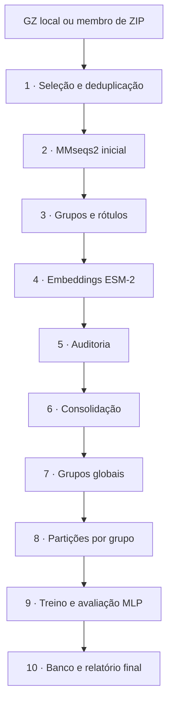
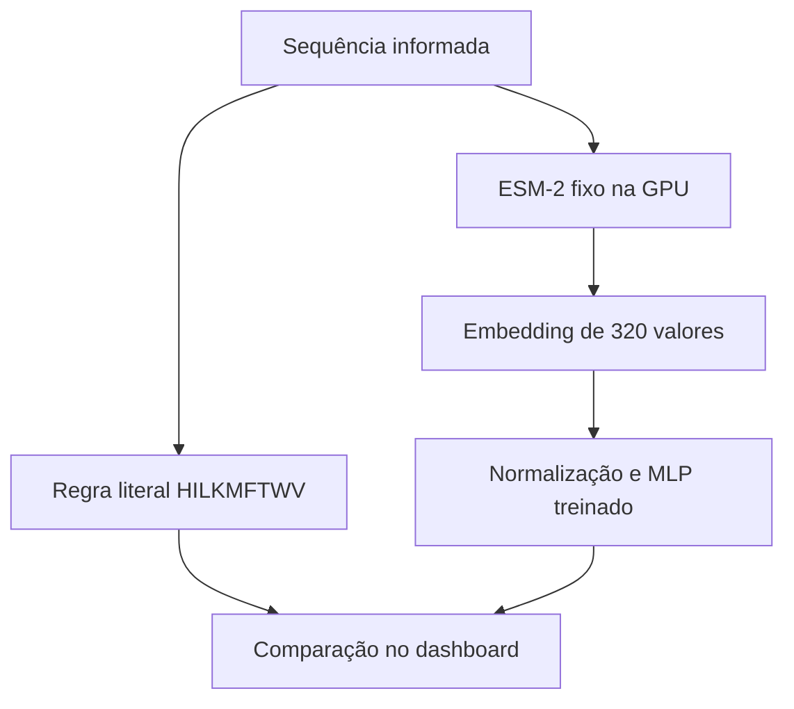

> **Registro de 13–14/10/2026.** Este documento descreve o sistema antes da validação de 18–19/10. O estado atual (consulta EC, GPU/CPU, Configurações, Fase 1 pelo painel, instalação) está no [README](../README.md) e na seção 3.2 do Dossiê Técnico.

---
tags: [tcc, proteinas, arquitetura, ia]
---

# Arquitetura do sistema de proteínas

O sistema tem uma interface local, um controlador de execução e scripts científicos. A interface pede ações e mostra os registros do controlador. O controlador mantém uma fila e chama cada script, em sequência, conservando os logs e resultados.



O dashboard roda em `127.0.0.1:8765`. O controlador executa uma tarefa pesada por vez. O banco da fila é `dados/sistema_tcc/controle.sqlite3`; cada experimento tem outro banco, `banco.sqlite3`, para seus dados científicos. Vetores ficam em NPY; SQLite registra seus índices e caminhos.

## Como as partes científicas se relacionam

| Componente | Entrada | Resultado | Aprende durante esta execução? |
|---|---|---|---|
| MMseqs2 / Linclust | Sequências FASTA | Representante e membros dos grupos | Não; aplica um algoritmo de agrupamento |
| Regra de rótulo | Letras da sequência | `Completa` ou `Incompleta` | Não; verifica presença de `HILKMFTWV` |
| ESM-2 | Sequência do representante | Vetor de 320 valores | Não; usa pesos pré-treinados fixos |
| MLP | Embedding e rótulo no treino | Classificador de duas classes | Sim; ajusta os pesos do classificador |
| Dashboard / SQLite | Eventos, relatórios e registros | Estado, métricas, busca e logs | Não |

MMseqs2 não define o rótulo `Completa`/`Incompleta`. No extrator do colega, uma função Python aplicava essa regra depois do agrupamento. A organização por semelhança e a classificação pela regra são responsabilidades diferentes.

## Etapas do experimento novo



### 1. Ler e selecionar

O controlador lista os `.gz` das pastas configuradas, inclusive dentro de ZIP. A seleção começa pelas fontes ordenadas por tamanho comprimido, nome e caminho. O limite se refere às primeiras sequências únicas elegíveis do recorte, não a uma amostra aleatória do NCBI.

O FASTA é lido sem extrair todos os arquivos para o SSD. As sequências são normalizadas para maiúsculas, e caracteres de parada no final são tratados pelo leitor. São elegíveis sequências não vazias, com até 512 resíduos e alfabeto aceito pelo pipeline (`ACDEFGHIKLMNPQRSTVWYBXZUO`). Comprimentos excessivos e caracteres não suportados são descartados e registrados. SHA-256 da sequência identifica repetições exatas.

Cada candidato recebe um UID interno como `p000000000`. O acesso NCBI e o cabeçalho original são guardados no banco. O limite pode interromper a leitura antes do fim de uma fonte; isso fica registrado e não equivale à validação integral daquele GZ.

### 2. Agrupar a entrada com MMseqs2

Linclust agrupa todo o recorte escolhido. A saída TSV associa representante e membro. O banco registra o grupo inicial de cada candidato. Um grupo tem um representante, cuja sequência será usada na etapa de embeddings.

Parâmetros registrados: identidade mínima 0,5; cobertura 0,8; `cov-mode=0`; `cluster-mode=1`; `alignment-mode=3`; 80 k-mers por sequência; limite de memória de divisão 8G; E-value 0,001. No Windows, o comando roda pelo Ubuntu WSL. O temporário fica em `/var/tmp`, evitando o limite do `/tmp` em RAM observado no seu ambiente.

Linclust é heurístico. Grupos separados não demonstram ausência de toda homologia. Versão, parâmetros, comando e hashes ficam nos relatórios.

### 3. Registrar os rótulos

Para cada sequência, a regra verifica:

```python
rotulo = "Completa" if set("HILKMFTWV") <= set(sequencia) else "Incompleta"
```

É uma regra de presença: um resíduo presente uma vez já satisfaz aquela letra. Ela não calcula proporções de aminoácidos, digestibilidade, qualidade nutricional ou função biológica. O nome herdado `Tipo_Nutricional` no CSV precisa ser interpretado com essa limitação.

O controlador produz um GZ/CSV próprio com `Arquivo_Origem`, `Grupo_Similaridade`, `ID_da_Proteina` e `Tipo_Nutricional`. Não precisa dos CSV históricos para executar um experimento novo.

### 4. Gerar embeddings

`processar_base_gpu.py` seleciona os representantes e usa funções de `piloto_esm_gpu.py`. O modelo é `facebook/esm2_t6_8M_UR50D`, na revisão `c731040fcd8d73dceaa04b0a8e6329b345b0f5df`. Ele é carregado do cache local, sem download no fluxo.

O ESM-2 roda em CUDA, com precisão float32 e uma sequência por inferência. O embedding da proteína é a média das representações dos resíduos, excluindo tokens especiais. O vetor final tem 320 valores. Checkpoints dos lotes permitem ao gerador reutilizar saídas confirmadas.

Se houver 1.000 candidatos e 650 grupos, o resultado esperado é até 650 embeddings de representantes. O banco ainda conserva os 1.000 candidatos. O limite inicial não garante 1.000 vetores.

### 5. Auditar

`validar_base_embeddings.py` confere lotes, hashes, dimensões, valores finitos, sequência/ID/rótulo e contagens. A auditoria roda na CPU e grava seu relatório separado. Uma aprovação técnica não é validação biológica das classes ou da utilidade do modelo.

### 6. Consolidar

`preparar_base_ia.py consolidar` reúne os lotes aprovados em `sequencias.fasta`, `indice.csv` e `embeddings.npy`, sem gerar embeddings novamente. A linha `i` da matriz corresponde à linha de dados `i` do índice e ao registro FASTA correspondente. Os hashes registram essa versão da base.

Os UIDs da base consolidada podem ser diferentes dos UIDs da entrada. O `id_original` da base aponta para o UID da entrada, e o SQLite mantém o vínculo até o acesso NCBI original.

### 7. Agrupar globalmente para as partições

`preparar_base_ia.py agrupar` aplica MMseqs2 ao FASTA consolidado. Esses grupos são usados para separar o conjunto de treino, validação e teste. A primeira chamada reduziu os candidatos a representantes; esta chamada produz o agrupamento explicitamente associado à base e seus hashes.

No fluxo atual há duas chamadas de MMseqs2. A segunda pode produzir pouca redução adicional, porque recebe representantes já agrupados. Ela foi mantida para reutilizar o procedimento existente de preparação das partições; não é uma nova prova de independência biológica.

### 8. Separar por grupos

`preparar_base_ia.py separar` atribui cada grupo inteiro a uma partição, por SHA-256 de semente e UID do representante. A semente é 42. As frações desejadas são 80% treino, 10% validação e 10% teste; os tamanhos observados são aproximados porque grupos não são quebrados.

O relatório verifica zero grupos compartilhados entre partições. O controlador também exige as duas classes nas partições antes do treino. Uma amostra pequena pode não satisfazer essa condição. A semente não é ajustada repetidamente em busca de um teste melhor.

### 9. Treinar e avaliar

`treinar_classificador_gpu.py` ajusta um MLP `320 → 64 → 2`. Normalização é calculada somente no treino. O script usa pesos de classe, Adam, lotes de treinamento e seleção do checkpoint pela acurácia balanceada da validação, com os controles de parada do script.

O controlador pede até 10 épocas. O conjunto de teste é usado na avaliação do modelo selecionado. Relatórios incluem histórico, métricas, matriz de confusão e previsões. A regra direta e uma previsão da classe majoritária servem de referências.

O MLP aprende a aproximar um rótulo determinístico que já pode ser calculado diretamente da sequência. O experimento demonstra o uso de embeddings e treinamento supervisionado; não comprova descoberta de uma nova propriedade nutricional.

### 10. Registrar e disponibilizar

O SQLite relaciona candidatos, grupos iniciais, representantes, índices dos embeddings, grupos globais e partições. O experimento registra seu modelo e métricas. O dashboard consulta esses registros e os arquivos de relatório.

## Consulta de uma sequência



A consulta não executa MMseqs2 nem treina outro modelo. Ela usa o checkpoint da execução selecionada e o cache do ESM-2. O resultado mostra a regra direta, a previsão do MLP, a concordância e os escores softmax sem calibração. Uma tarefa pesada em andamento mantém a consulta aguardando na fila.

## Continuidade e rastreabilidade

Cada execução fica em `dados/execucoes_tcc/exp_DATA_IDENTIFICADOR/`, com fontes registradas, parâmetros, cópias dos scripts científicos e seus hashes. Fases concluídas têm confirmação e arquivos associados. A retomada valida essas confirmações; não começa a coleção inteira novamente.

O painel consulta o servidor a cada 2 segundos. Pausa e encerramento são cooperativos entre fases. O sistema não inicia infinitos novos treinos ao terminar um experimento ou ao iniciar com o Windows.
